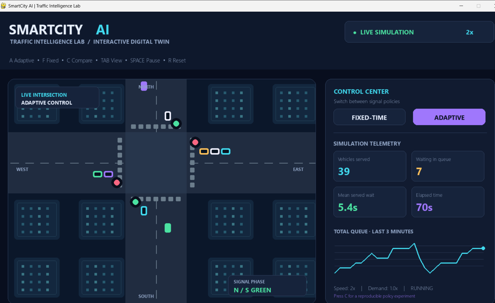
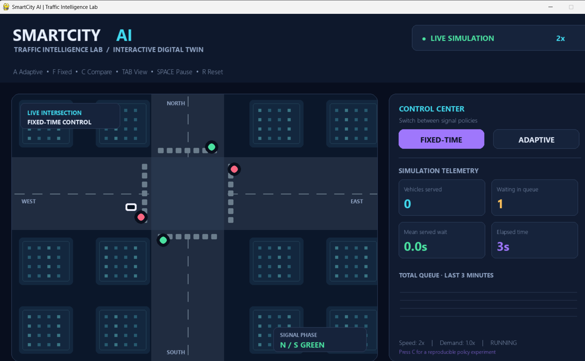
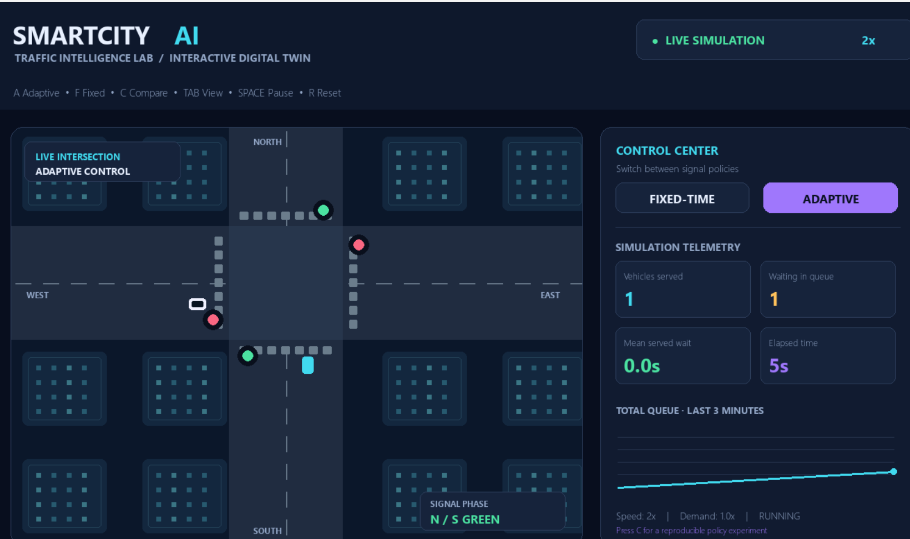
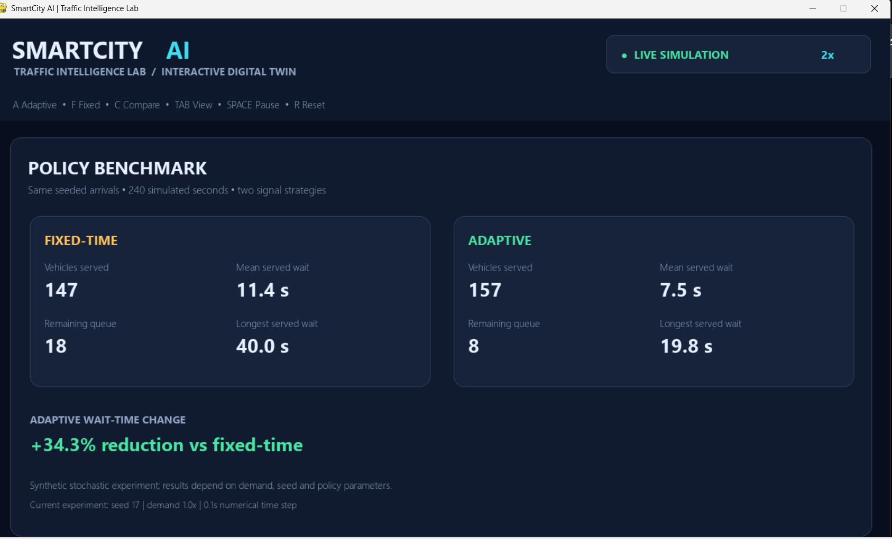
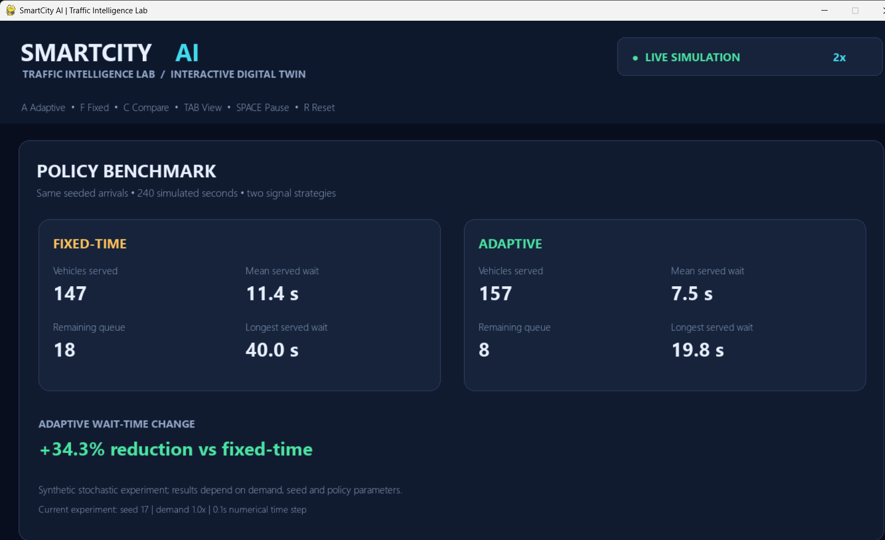
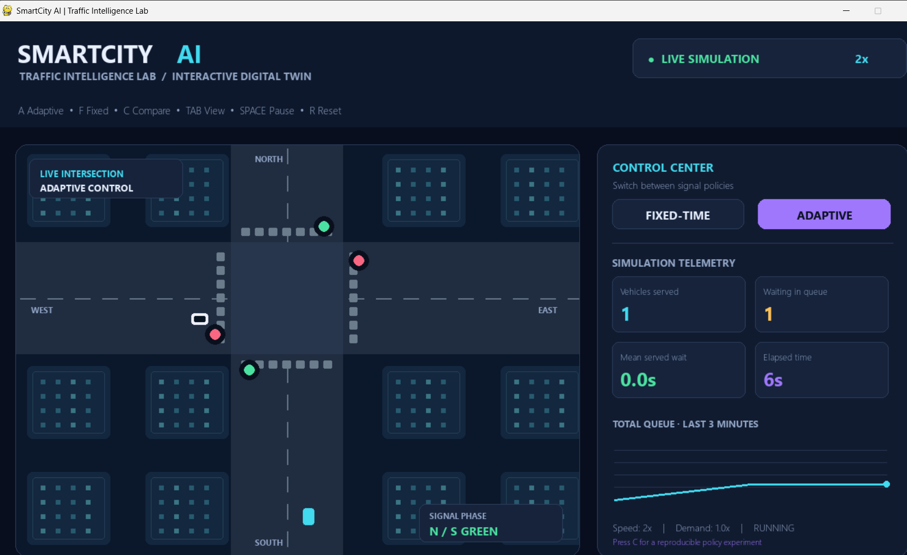

# SmartCity AI — Traffic Intelligence Lab

A **Python 3.10-compatible**, interactive traffic-intersection digital twin with a neon city visualization, vehicle queues, traffic signals, a reproducible fixed-time versus adaptive-signal experiment, live telemetry, and CSV export.

> **Research integrity:** This is a **synthetic traffic simulation**, not a calibrated model of a real city. "AI" is project branding; the adaptive controller uses transparent, rule-based queue feedback, **not** a trained machine-learning model. The benchmark is a demonstration, not a claim of real-world superiority.

## Highlights

- **Live animated intersection:** Four arrival directions, visible queues, moving vehicles, green/yellow/all-red signal phases, and urban visualization.
- **Two real signal controllers:** Fixed-time alternates every 16 seconds; adaptive responds to queue imbalance with a 7-second minimum and 28-second maximum green, plus safe transition intervals.
- **Fair experiment:** Both strategies receive the same seeded stochastic vehicle arrivals. Compare throughput, waiting times, remaining queue, and maximum observed wait after 240 simulated seconds.
- **Control scenarios:** Increase/decrease traffic demand, speed up simulation, pause, reset, or switch policies.
- **Export results:** Press **S** to save `benchmark_results.csv` in the project folder.
- **No heavyweight dependencies or training:** Requires only Pygame.

## Quick start on Windows

1. Install **Python 3.10** from [python.org](https://www.python.org/downloads/) if necessary.
2. Extract the ZIP completely (do not run the launcher inside the ZIP).
3. Double-click **`START_HERE.bat`**. The launcher creates `.venv` and installs Pygame on first run (internet required).
4. The simulation opens in a desktop window. If Windows cannot find Python, check `py -3.10 --version` in Command Prompt and ensure Python is installed.

Alternative terminal launch:

```powershell
py -3.10 -m venv .venv
.venv\Scripts\python -m pip install -r requirements.txt
.venv\Scripts\python main.py
```

## Controls

| Key | Action |
| --- | --- |
| `A` / `F` | Adaptive / fixed-time signal controller (restarts the live scenario) |
| `C` | Run paired benchmark and show comparison screen |
| `Tab` | Toggle benchmark and live view |
| `Space` | Pause / resume |
| `R` | Reset live simulation |
| `↑` / `↓` | Increase / decrease vehicle demand and restart |
| `+` / `-` | Increase / decrease simulation speed (1–8x) |
| `S` | Export paired benchmark as CSV |
| `Esc` | Exit |

You can also click the **FIXED-TIME** and **ADAPTIVE** buttons on the live screen.

## How the simulation works

Each approach generates independent Poisson arrivals at fixed seed and configured demand. Vehicles queue until their movement has a green phase. Two lanes (north/south or east/west) can discharge concurrently, with a 1.9-second minimum headway per approach. Each phase transition includes 1.6 seconds of yellow and 0.7 seconds of all-red clearance.

**Fixed-time:** Switches after 16 seconds of green.

**Adaptive:** Holds a green for at least 7 seconds, then may switch if its queues are empty or opposing demand becomes substantially greater; switches no later than 28 seconds. This is a simple, interpretable *actuated heuristic*, not reinforcement learning.

**Experiment:** `compare()` independently replays both policies with the same seed and demand for 240 simulated seconds using 0.1-second steps. Reported mean wait is measured **only for vehicles that have departed**, so compare it together with throughput and the remaining queue to avoid misleading conclusions. This simplified model omits turns, pedestrians, downstream congestion, and real signal engineering constraints.

## Screenshots

These screenshots were captured from the working Windows application. The benchmark uses synthetic, seeded traffic arrivals; results are not claims about real intersections.

### Live adaptive signal control



### Fixed-time signal control



### Adaptive control at the start of a run



### Reproducible policy benchmark



In this example seeded simulation, adaptive control recorded a **34.3% reduction in mean wait among served vehicles**, with 157 versus 147 vehicles served. Performance depends on traffic demand, seed, and policy parameters.

### Additional benchmark view



### Live queue monitoring



## Repository layout

```text
SmartCity-AI/
├── main.py
├── START_HERE.bat
├── START_HERE_PYTHON.bat
├── requirements.txt
├── .gitignore
├── LICENSE
├── README.md
├── assets/
└── screenshots/
```

## Technology

Python 3.10+, Pygame, Python standard library (`random`, `collections`, `dataclasses`, `csv`). No API key, network service, or pretrained model required.

## License

MIT. Review the copyright line in `LICENSE` before publishing.
